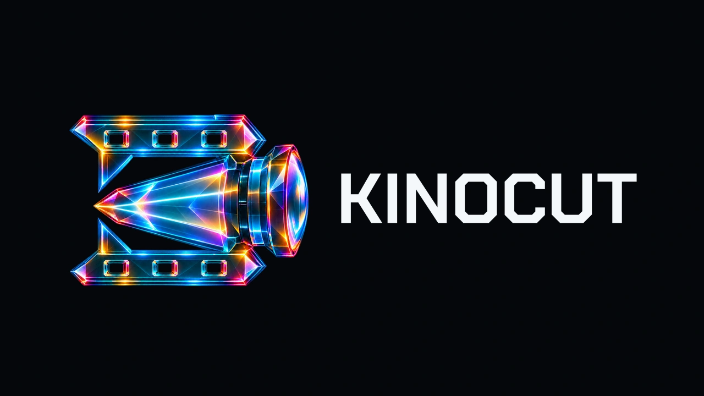

<p align="center">
  <a href="https://kinocut.dev/">
    
  </a>
</p>

<!-- mcp-name: tech.kyanitelabs/kinocut -->

<h1 align="center">Kinocut</h1>

<p align="center">
  <strong>Your agent edits the video. You approve the cut.</strong><br>
  A local, guardrailed video-editing MCP server, Python client and <code>kino</code> CLI.
  Free, Apache-2.0. Formerly mcp-video.
</p>

<p align="center">
  <a href="https://pypi.org/project/kinocut/"></a>
  <a href="https://kinocut.dev/"></a>
  <a href="https://github.com/KyaniteLabs/kinocut/actions/workflows/ci.yml"></a>
  
  
  
  
</p>

You tell your agent, *"cut the best 45 seconds of this interview into a captioned vertical
short."* Without help, the agent guesses FFmpeg flags, overwrites your source, and hands
back a file it never looked at.

Kinocut gives the agent typed tools instead. Every edit is checked before FFmpeg runs, writes
to a new file unless you allow an overwrite, and returns a structured result the agent can
inspect. Quality gates catch black frames, silence and bad loudness before you see the cut,
and a **Video Receipt** records what was asked, what ran and what changed.

Everything runs on your machine. No account, no upload, no credits.

## Install

Kinocut needs [FFmpeg](https://ffmpeg.org/) on your `PATH` (`brew install ffmpeg`,
`sudo apt install ffmpeg`, or `winget install ffmpeg`).

Add it to Claude Code:

```bash
claude mcp add kinocut -- uvx --from kinocut==1.16.5 kino --mcp
```

Or to any MCP client that reads a JSON config (Claude Desktop, Cursor, Windsurf, Zed):

```json
{
  "mcpServers": {
    "kinocut": {
      "command": "uvx",
      "args": ["--from", "kinocut==1.16.5", "kino", "--mcp"]
    }
  }
}
```

Or install the package and check your machine:

```bash
pip install kinocut==1.16.5
kino doctor
```

`kino doctor` lists which features are ready and what each missing one needs. Optional
features install as extras; the [install matrix](docs/INSTALL.md) lists them all.

For Claude Desktop extension installs, `python3 scripts/build-mcpb.py` builds a local `.mcpb`
from `mcpb/`. It is unsigned and labeled **user-configured-local-access**: it launches your
own Python environment, still needs Node and FFmpeg, and is not a sandbox. See
[docs/MCPB.md](docs/MCPB.md).

## What your agent sees

An agent pays for every tool description it reads, on every turn. Kinocut keeps the default
list small and puts the rest one call away.

| Mode | Set with | Tools listed | What's in it |
| --- | --- | ---: | --- |
| Default | nothing | 18 | 8 hot-path tools, 8 operation families, `list_operations`, `describe_operation` |
| Profile | `KINOCUT_TOOLS=profile:editor` (19 profiles) | varies | One job's tools by name, plus the families |
| Everything | `KINOCUT_TOOLS=all` | 206 | Every tool by its own name |

The hot path is `video_info`, `video_trim`, `video_merge`, `video_add_text`,
`video_add_audio`, `video_extract_frame`, `video_shorts` and `video_doctor`.

The eight families (`video_edit_ops`, `video_effects_ops`, `audio_ops`, `video_ai_ops`,
`image_ops`, `video_qc_ops`, `video_plan_ops`, `platform_ops`) reach every other operation
in the catalog. The agent calls `list_operations` to see what a family can do and
`describe_operation` to fetch one operation's full schema. Family dispatch runs the same
code as the named tool, so the results are identical. See
[MCP operation families](docs/MCP_TOOL_FAMILIES.md).

The 18-tool default listing is about 22 KB of JSON. The full catalog is about 178 KB.

## Review a cut where you already are

- **Hermes Desktop chat.** `video_review_card` writes an HTML card with a contact sheet,
  duration, resolution and codec, and three buttons: Approve & export, Dig in, Try another
  range. An opt-in Desktop plugin shows live render progress in the status bar and a
  "Kinocut renders" pane. See [the Hermes plugin](plugins/kinocut/README.md).
- **A paired Hermes Gadget TV.** The plugin skill can put the cut on the TV and map the
  remote's Approve and Reject to Approve & export and Try another range. The TV needs a URL
  it can fetch; Kinocut does not serve one.
- **Anywhere else.** `kino release-checkpoint clip.mp4` writes a thumbnail, a storyboard
  and a pass/fail quality report next to the clip.

## What it can do

| Job | Where to start |
| --- | --- |
| Trim, merge, caption, resize, convert, overlay, crop, speed | Hot path and `video_edit_ops` |
| One-call vertical shorts from chosen ranges | `video_shorts` |
| Podcast or stream to Shorts, Reels and TikTok packages | [Tutorial](docs/TUTORIAL_PODCAST_TO_SHORTS.md), [stream-to-shorts](docs/STREAM_SHORTS.md) |
| Loudness, quality and release gates | `video_qc_ops`, [quality evidence](docs/QUALITY_EVIDENCE.md) |
| Multi-step jobs from one JSON spec, resumable | [Workflow engine](docs/WORKFLOWS.md) |
| Diagnose and repair a damaged clip without changing its story | [Video rescue](docs/RESCUE.md) |
| Review and salvage AI-generated video | [AI-video review](docs/AI_VIDEO_REVIEW_AND_SALVAGE.md) |
| A two-cam edit from one stitched 360 MP4 | [360 assembly](docs/360_ASSEMBLY.md) |
| Cut a product out of a still or turntable video | [Product matte](docs/PRODUCT_MATTE.md) |
| Match and grade a set of stills to a hero image | [Still plates](docs/STILL_PLATES.md) |
| Mix, duck, master and check speech audio | [Audio mixing](docs/AUDIO_MIXING.md), [sound mixes](docs/SOUND_MIX_REQUESTS.md) |
| Code-driven motion graphics | Hyperframes and Revideo tools, see [tool reference](docs/TOOLS.md) |
| Signed provenance on final exports | [C2PA](docs/C2PA_PROVENANCE.md) |

The same engine sits behind all three interfaces:

```python
from kinocut import Client

kino = Client()
clip = kino.trim("interview.mp4", start="00:02:15", duration=45)
kino.ai_transcribe(clip.output_path, output_srt="captions.srt")
captioned = kino.subtitles(clip.output_path, subtitle_file="captions.srt")
vertical = kino.resize(captioned.output_path, aspect_ratio="9:16")
kino.release_checkpoint(vertical.output_path)
```

```bash
kino info interview.mp4
kino trim interview.mp4 -s 00:02:15 -d 45
kino release-checkpoint clip.mp4 --profile ui-capture-dark
```

References: [MCP tools](docs/TOOLS.md) · [Python client](docs/PYTHON_CLIENT.md) ·
[CLI](docs/CLI_REFERENCE.md) · [Video Receipts](docs/VIDEO_RECEIPT.md) ·
[agent discovery](docs/AI_AGENT_DISCOVERY.md) · [all docs](docs/README.md) · [`llms.txt`](llms.txt)

## Safe by default

- **New files, not overwrites.** Writing over an existing file needs an explicit `overwrite`.
- **Checked before FFmpeg runs.** Filter ranges, merge compatibility, mix levels, overlay
  opacity and text timing are validated first, and errors end with the exact retry call.
- **No network calls you didn't ask for.** Optional model features are off until you turn
  them on; see [vision and network controls](docs/VISION_PRIVACY.md).
- **Nothing gets posted.** Kinocut renders and packages. Publishing stays with you.

What it won't do: Kinocut renders real media only. No generation adapter exists for
text-to-video or paid image generation, and caption speech uses local stock speech
(eSpeak NG), not a neural voice. The `kinocut_sound` program ships its thin S12 join; its
benchmark is 64 synthetic clips, not a full episode and not human listening approval.

## Releases

| | Version | Surface |
| --- | --- | --- |
| **Published** on PyPI, npm and the MCP Registry | **1.16.5** (2026-10-27) | 205 MCP tools with `KINOCUT_TOOLS=all`, 20 by default, 177 CLI commands |
| **This source** (`master`) | **2.0.0** candidate | 206 MCP tools with `KINOCUT_TOOLS=all`, 18 by default, 177 CLI commands |
| **Compatibility package** | `mcp-video==1.6.20` | Installs `kinocut==1.16.5` for anyone still on the old name; the prepared `mcp-video==1.6.21` installs `kinocut==2.0.0` |

Install from PyPI for everything above, including the optional object-matte extra
(`kinocut[object-matte]==1.16.5`, published 1.16.5), which adds no new MCP tool.

Full notes: [CHANGELOG.md](CHANGELOG.md) · published [1.16.5 on PyPI](https://pypi.org/project/kinocut/1.16.5/)

| | |
| --- | --- |
| **Source** | [GitHub](https://github.com/KyaniteLabs/kinocut) (canonical) · [Forgejo](https://git.kyanitelabs.tech/KyaniteLabs/kinocut) (downstream mirror) |
| **MCP Registry** | [`tech.kyanitelabs/kinocut`](https://registry.modelcontextprotocol.io/v0/servers/tech.kyanitelabs%2Fkinocut/versions/latest) |
| **PyPI** | [`kinocut`](https://pypi.org/project/kinocut/) |
| **Site** | [kinocut.dev](https://kinocut.dev/) |
| **Runs on** | macOS, Linux, Windows, with Python 3.11+ and FFmpeg |

### Coming from mcp-video

The project was called mcp-video until 2026-07-10. The old import (`mcp_video`), command
(`mcp-video`), `MCP_VIDEO_*` variables and `~/.mcp-video` data directory still work. New
setups should use `kinocut`, `from kinocut import Client` and `kino`. See
[the rename notes](docs/RENAME.md).

## En español

Kinocut es un servidor MCP local para que tu agente de IA edite video con barreras de
seguridad: recorta, une, subtitula, mezcla audio, crea Shorts y revisa la calidad antes de
entregarte el corte. Nunca sobrescribe tus archivos sin permiso y no sube nada a la nube.
La versión publicada es **1.16.5**. Necesitas [FFmpeg](https://ffmpeg.org/) en el `PATH`.

```bash
pip install kinocut==1.16.5
kino doctor
claude mcp add kinocut -- uvx --from kinocut==1.16.5 kino --mcp
```

`kino doctor` te dice qué funciones están listas y qué falta instalar. La documentación
completa está en inglés; los mensajes de error principales son bilingües.

## Develop

```bash
git clone https://github.com/KyaniteLabs/kinocut.git
cd kinocut
python3 -m venv .venv && source .venv/bin/activate
pip install -e ".[dev]"
pytest -q -m "not slow and not hyperframes"
```

[Contributing](CONTRIBUTING.md) · [Testing](docs/TESTING.md) · [Security](SECURITY.md) ·
[Support](SUPPORT.md) · [Governance](GOVERNANCE.md) · [Maintainers](MAINTAINERS.md) · [Code of Conduct](CODE_OF_CONDUCT.md) ·
[Roadmap](ROADMAP.md)

Want a public MCP URL without opening router ports?
[hyperframes-selfhost](https://github.com/ismailkattakath/hyperframes-selfhost) is a
community Apache-2.0 reference stack (Tailscale Funnel, Caddy, Google OAuth). It is not
affiliated with KyaniteLabs; review it against your own threat model.

## Contributors

Kinocut is better because people outside the core team sent code and sharp bug reports.
A report with reproduction steps and a real traceback is a contribution, and every one is
credited here and in the [CHANGELOG](CHANGELOG.md).

- **[@guillaume-hestia-projekt](https://github.com/guillaume-hestia-projekt)**: 19 reproducible bug reports from building on `kinocut.Client` ([#546](https://github.com/KyaniteLabs/kinocut/issues/546)–[#578](https://github.com/KyaniteLabs/kinocut/issues/578)), plus fixes: FFmpeg children no longer inherit stdin ([#559](https://github.com/KyaniteLabs/kinocut/pull/559)), composite-layers canvas fps ([#558](https://github.com/KyaniteLabs/kinocut/pull/558)) and honest `normalize_audio` ([#569](https://github.com/KyaniteLabs/kinocut/pull/569)), shipped in 1.15.3. Their crop, trim, noise-floor, one-pass mixing and timed-layer patches were adapted into 1.16.0 ([#586](https://github.com/KyaniteLabs/kinocut/pull/586)).
- **[@WohaibHasan](https://github.com/WohaibHasan)**: absolute trim-end handling ([#493](https://github.com/KyaniteLabs/kinocut/pull/493)), Windows drive preservation ([#496](https://github.com/KyaniteLabs/kinocut/pull/496)) and portable UTF-8 CLI test capture ([#498](https://github.com/KyaniteLabs/kinocut/pull/498)).
- **[@Beritwu](https://github.com/Beritwu)**: frame-exact `create-from-images` with rational frame rates and list input ([#616](https://github.com/KyaniteLabs/kinocut/pull/616), shipped in 1.16.2), and the opt-in exact probe ([#599](https://github.com/KyaniteLabs/kinocut/pull/599), shipped in 1.16.5).
- **[@cnw-L](https://github.com/cnw-L)**: Windows drive paths survive the lavfi `movie=` filter ([#532](https://github.com/KyaniteLabs/kinocut/pull/532)), shipped in 1.15.3.
- **[@gerardoscaglia-creator](https://github.com/gerardoscaglia-creator)**: a Windows MCP-mode investigation ([#445](https://github.com/KyaniteLabs/kinocut/issues/445)) that exposed both diagnostics gaps fixed in 1.15.0, and the portable file-locking fix ([#446](https://github.com/KyaniteLabs/kinocut/pull/446)) that shipped with them.
- **[@pedropaav-art](https://github.com/pedropaav-art)**: Windows filter-option path escaping ([#458](https://github.com/KyaniteLabs/kinocut/pull/458)), shipped in 1.15.0.
- **[@linhaixin45-cmyk](https://github.com/linhaixin45-cmyk)**: a `kino doctor` Python-version floor with a visible install hint ([#459](https://github.com/KyaniteLabs/kinocut/pull/459)), shipped in 1.15.0.
- **[@betsmayank](https://github.com/betsmayank)**: the first merged external fix, so Hyperframes `init` no longer hangs under MCP without a TTY ([#361](https://github.com/KyaniteLabs/kinocut/pull/361)).
- **[@AnttonioAzevedo](https://github.com/AnttonioAzevedo)**: caught silence removal writing corrupt MP4s ([#467](https://github.com/KyaniteLabs/kinocut/issues/467), fixed in [#506](https://github.com/KyaniteLabs/kinocut/pull/506)).
- **[@Mimatovitch](https://github.com/Mimatovitch)**: reported the macOS process-cleanup regression ([#594](https://github.com/KyaniteLabs/kinocut/issues/594)), fixed in 1.16.1 ([#596](https://github.com/KyaniteLabs/kinocut/pull/596)).
- **[@Zoroassistant23](https://github.com/Zoroassistant23)**: investigated [#594](https://github.com/KyaniteLabs/kinocut/issues/594) and proposed a patch with macOS checks and a regression test ([#595](https://github.com/KyaniteLabs/kinocut/pull/595)).
- **[@austinwmson](https://github.com/austinwmson)** and **[@ismailkattakath](https://github.com/ismailkattakath)**: reports that closed real gaps, `remotion_still` runtime props ([#306](https://github.com/KyaniteLabs/kinocut/issues/306)) and the self-host reference stack ([#432](https://github.com/KyaniteLabs/kinocut/issues/432)).
- **[@Dodothereal](https://github.com/Dodothereal)** and **@OyaAIProd** (account since deleted): early external PRs, including ASS PlayRes for vertical burns ([#378](https://github.com/KyaniteLabs/kinocut/pull/378)).

## License

Apache 2.0. See [LICENSE](LICENSE). Built on [FFmpeg](https://ffmpeg.org/),
[Hyperframes](https://hyperframes.io/) and the [Model Context Protocol](https://modelcontextprotocol.io/).

Made by [Simon Gonzalez De Cruz](https://github.com/simongonzalezdc) at
[KyaniteLabs](https://kyanitelabs.tech). Sibling projects:
[Epoch](https://github.com/KyaniteLabs/Epoch) (time estimates for agents),
[DialectOS](https://github.com/KyaniteLabs/DialectOS) (Spanish dialect localization) and
[checkyourself](https://github.com/KyaniteLabs/checkyourself) (production-readiness checks
for AI-built code). If Kinocut saved you editing hours: [ko-fi.com/kyanitelabs](https://ko-fi.com/kyanitelabs).
